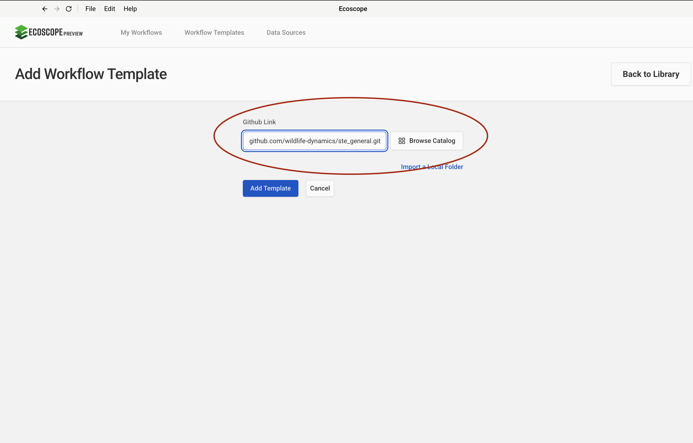
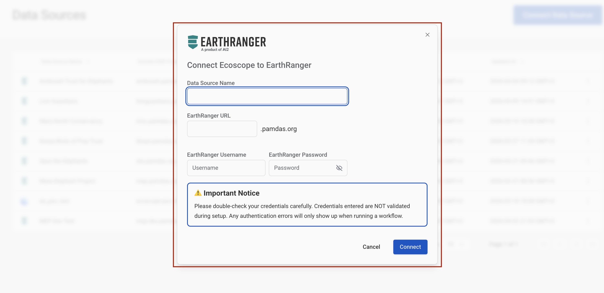
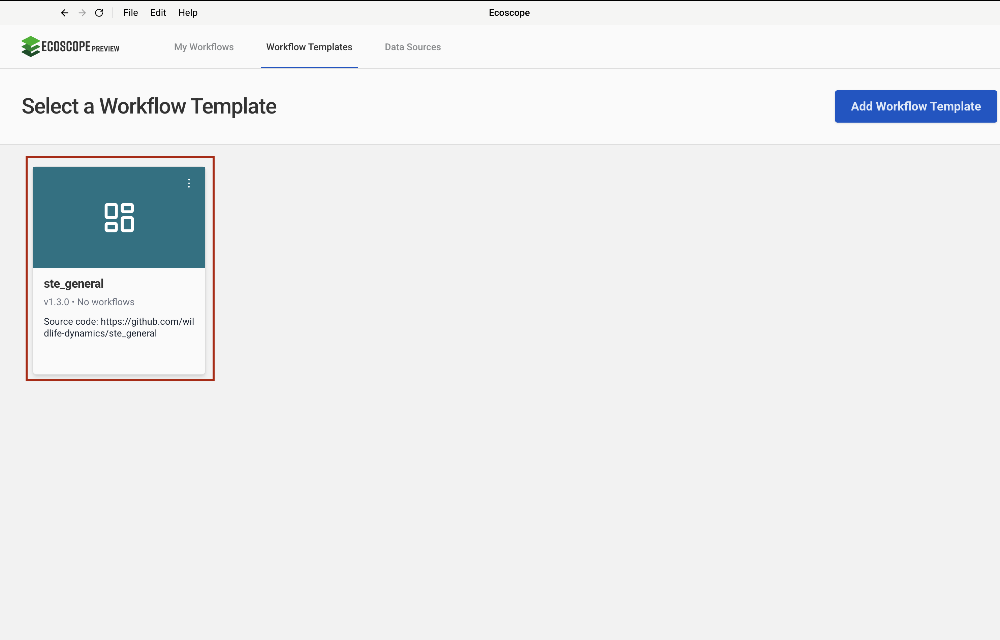
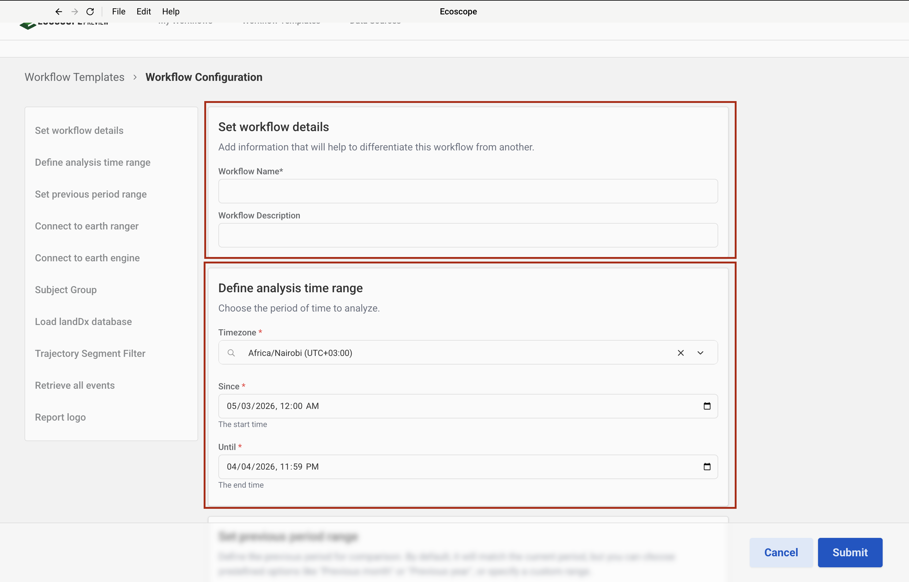
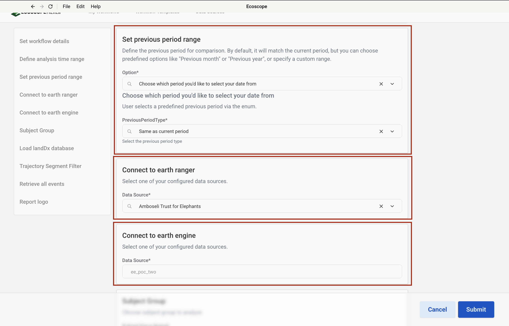
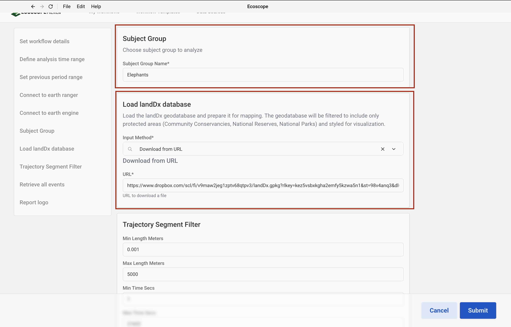
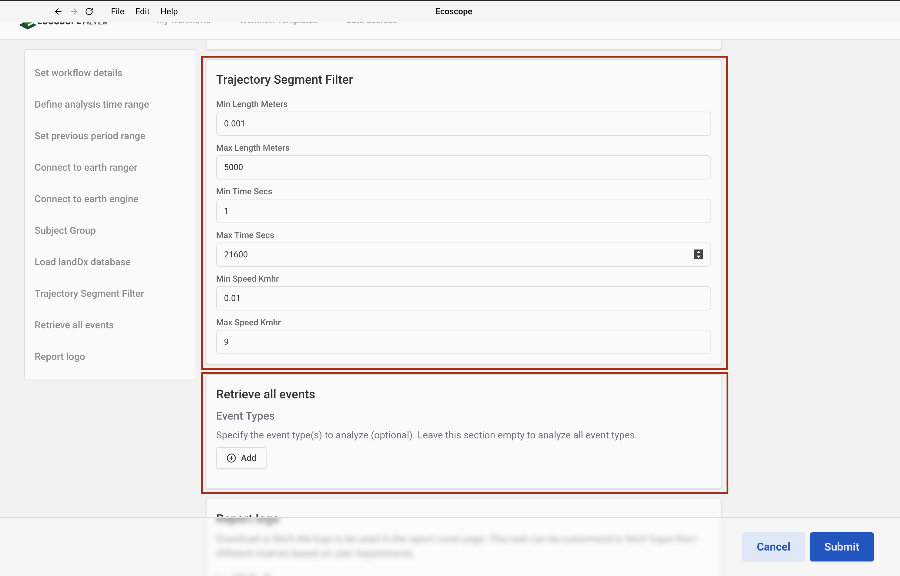
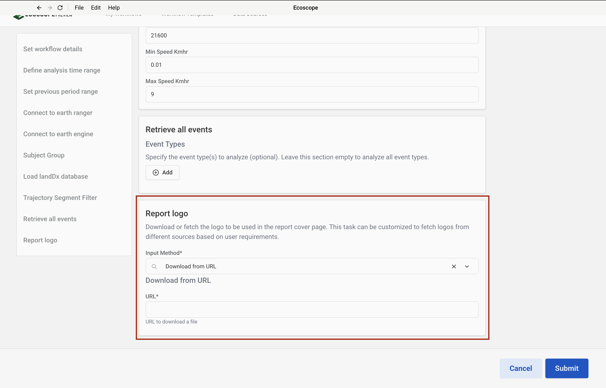

# STE General Workflow — User Guide

This guide walks you through configuring and running the STE General Workflow, which generates a comprehensive elephant movement analysis report for Save the Elephants sourced from EarthRanger.

---

## Overview

The workflow processes GPS observations for a chosen subject group and produces a full suite of spatial, temporal, and ecological analyses:

**Movement maps**
- A **Movement Tracks Map** — current and previous period trajectories overlaid together, coloured by period (current vs. previous) for direct comparison
- A **Subject Tracks Map** — trajectories coloured per individual subject using EarthRanger hex colours

**Home range maps**
- An **Overall Home Range Map** — Elliptical Time Density (ETD) at percentiles 50–99.9%, coloured by the RdYlGn palette
- A **Filtered Home Range Map** — 99th percentile home range only, shown in a single chocolate tone
- A **Protected Areas Home Range Map** — ETD computed from fixes inside protected land (Community Conservancies, National Reserves, National Parks)
- An **Unprotected Areas Home Range Map** — ETD computed from fixes outside protected land
- **Seasonal Home Range Maps** (per subject) — 99.9th percentile ETD split into wet and dry seasons, coloured by season

**Habitat use maps**
- A **Recursion Events Raster** — ecograph network weight raster classified into 6 natural-break bins, green → red
- A **Dry Season Mean Speed Raster** — mean movement speed raster for dry-season fixes, 6 natural-break bins, green → red
- A **Wet Season Mean Speed Raster** — same as above for wet-season fixes

**Activity maps**
- A **Time of Day Dominance Map** — grid showing whether each cell is used predominantly at night (dark blue) or during the day (cornflower blue)
- A **Night Fixes Map** — grid cells where ≥ 65% of fixes are nocturnal

**Event maps**
- An **Elephant Sightings / Collaring Events Map** — scatter plot of EarthRanger events for the analysis period

**Charts and tables**
- A **Protection Status Bar Chart** — proportion of fixes inside vs. outside protected areas
- A **Seasonal Windows CSV** — NDVI-derived wet/dry season date ranges used to label trajectories

**Reports**
- A **Word document report** (`.docx`) — cover page (logo, subject count, report period) plus a general per-subject section
- An **interactive dashboard**

---

## Prerequisites

Before running the workflow, ensure you have:

- Access to an **EarthRanger** instance containing the subject group to analyse
- Access to a **Google Earth Engine** service account (for NDVI-based seasonal window detection and satellite base layers)
- The **landDx geodatabase** (`.gpkg`) — the standard STE Dropbox URL is pre-filled; supply a custom URL or local path if needed

---

## Step-by-Step Configuration

### Step 1 — Add the Workflow Template

In the workflow runner, go to **Workflow Templates** and click **Add Workflow Template**. Paste the GitHub repository URL into the **Github Link** field:

```
https://github.com/wildlife-dynamics/ste_general.git
```

Then click **Add Template**.



---

### Step 2 — Configure Connection

Navigate to **Data Sources** and click **Connect**. A dialog will appear prompting you to **Select Data Source Type**. This workflow requires two connections:

| Data Source Type | Purpose |
|-----------------|---------|
| **EarthRanger** | Pull subject observations and collaring events |
| **Google Earth Engine** | Fetch satellite imagery and compute NDVI-based seasonal windows |

Select **EarthRanger** first and complete Step 3, then repeat and select **Google Earth Engine** for Step 4.


---

### Step 3 — Add an EarthRanger Connection

After selecting **EarthRanger** in Step 2, fill in the connection form:

- **Data Source Name** — a label to identify this connection
- **EarthRanger URL** — your instance URL (e.g. `your-site.pamdas.org`)
- **EarthRanger Username** and **EarthRanger Password**

> Credentials are not validated at setup time. Any authentication errors will appear when the workflow runs.

Click **Connect** to save.



---

### Step 4 — Add a Google Earth Engine Connection

After selecting **Google Earth Engine** in Step 2, fill in the connection form:

- **Data Source Name** — a label to identify this connection
- **Private Key** — click **Browse** to select your GEE service account private key file (JSON format)

> To generate a private key, follow the instructions in the [Setup Guide](https://developers.google.com/earth-engine/guides/service_account). The key is stored encrypted and used only to authenticate with Google Earth Engine.

Click **Connect** to save.


---

### Step 5 — Select the Workflow

After the template is added, it appears in the **Workflow Templates** list as **ste_general**. Click it to open the workflow configuration form.

> The card may show **Initializing…** briefly while the environment is set up.



---

### Step 6 — Set Workflow Details and Define Analysis Time Range

The configuration form opens with two sections at the top.

**Set workflow details**

| Field | Description |
|-------|-------------|
| Workflow Name | A short name to identify this run |
| Workflow Description | Optional notes (e.g. date range or subject group) |

**Define analysis time range**

| Field | Description |
|-------|-------------|
| Timezone | Select the local timezone (e.g. `Africa/Nairobi UTC+03:00`) |
| Since | Start date and time of the analysis period |
| Until | End date and time of the analysis period |

All subject tracks, home ranges, and activity maps are computed within this window.



---

### Step 7 — Set Previous Period Range, Connect to EarthRanger, and Connect to EarthEngine

Scroll down to configure the next three sections.

**Set previous period range**

This period drives the "Previous tracks" layer on the Movement Tracks Map, enabling direct before-and-after comparison alongside the current period tracks.

| Field | Default | Description |
|-------|---------|-------------|
| Option | Choose which period to select | Whether to use a predefined period type or specify a custom date range |
| PreviousPeriodType | `Same as current period` | Predefined period (e.g. Same as current, Previous month, Previous year) |

**Connect to earth ranger**

Select the EarthRanger data source configured in Step 3 from the **Data Source** dropdown.

**Connect to earth engine**

Select the Google Earth Engine data source configured in Step 4 from the **Data Source** dropdown. This connection is used to retrieve NDVI satellite data for detecting wet and dry seasonal windows, which are then used to label trajectories and generate seasonal home range and speed raster maps.



---

### Step 8 — Subject Group and Load landDx Database

**Subject Group**

| Field | Default | Description |
|-------|---------|-------------|
| Subject Group Name | `Elephants` | Name of the subject group to pull from EarthRanger |

**Load landDx database**

The landDx geodatabase supplies the protected area and conservancy boundary layers displayed on all maps. The workflow filters the database to three area types and styles them as follows:

| Area Type | Map colour |
|-----------|-----------|
| Community Conservancy | `#a6b697` (sage green) |
| National Reserve | `#88a78e` (muted green) |
| National Park | `#115631` (dark forest green) |

Choose how to supply the file:

| Input Method | When to use | What to provide |
|-------------|-------------|----------------|
| **Download from URL** | File is hosted remotely (e.g. Dropbox) | Paste the direct download URL into the **URL** field |
| **Local path** | File is already on the machine running the workflow | Enter the absolute file path to the `.gpkg` file |

> The standard STE landDx Dropbox URL is pre-filled. Leave it unchanged unless you have a custom or updated version of the file.



---

### Step 9 — Trajectory Segment Filter, Retrieve All Events, and Report Logo

**Trajectory Segment Filter**

Applied to both the current and previous period trajectories before any analysis. Removes GPS noise and biologically unrealistic movement segments.

| Field | Default | Description |
|-------|---------|-------------|
| Min Length Meters | `0.001` | Discard segments shorter than this distance |
| Max Length Meters | `5000` | Discard segments longer than this distance |
| Min Time Secs | `1` | Discard segments shorter than this duration |
| Max Time Secs | `21600` | Discard segments longer than this duration (6 hours) |
| Min Speed Knots | `0.01` | Discard segments below this average speed |
| Max Speed Knots | `9` | Discard segments above this average speed |

**Retrieve all events**

| Field | Description |
|-------|-------------|
| Event Types | Filter to specific EarthRanger event types (click **Add** to add entries; leave empty to include all event types) |

**Report logo**

Provide the logo image to appear on the report cover page.

| Input Method | What to provide |
|-------------|----------------|
| **Download from URL** | Paste the direct download URL into the **URL** field |





---

## Running the Workflow

Once all parameters are configured, click **Submit**. The runner will:

1. Pull subject GPS observations (current and previous period) from EarthRanger.
2. Process relocations and apply the trajectory segment filter to both periods.
3. Query Google Earth Engine to determine NDVI-derived wet and dry seasonal windows; label each trajectory segment accordingly.
4. Load and style the landDx geodatabase boundary layers.
5. Generate the Movement Tracks Map (current + previous overlay) and the Subject Tracks Map.
6. Fetch EarthRanger events and generate the Elephant Sightings map.
7. Compute Elliptical Time Density home ranges: overall, filtered 99th percentile, protected/unprotected split, and per-subject seasonal.
8. Generate the Recursion Events raster and dry/wet season Mean Speed rasters.
9. Compute the Day/Night Dominance grid and Night Fixes grid.
10. Render the Protection Status bar chart.
11. Assemble the Word report (cover page + general section) and the dashboard.
12. Save all outputs to the directory specified by `ECOSCOPE_WORKFLOWS_RESULTS`.

---

## Output Files

All outputs are written to `$ECOSCOPE_WORKFLOWS_RESULTS/`:

| File | Description |
|------|-------------|
| `relocations.geoparquet` | Current period GPS fix locations with day/night labels |
| `previous_period_relocations.geoparquet` | Previous period GPS fix locations |
| `trajectories.geoparquet` | Current period trajectory segments with season labels |
| `previous_period_trajectories.geoparquet` | Previous period trajectory segments |
| `home_range_etd.geoparquet` | Overall ETD home range polygons (50–99.9th percentiles) |
| `protected_areas_home_range_etd.geoparquet` | ETD home range for fixes inside protected areas |
| `unprotected_areas_home_range_etd.geoparquet` | ETD home range for fixes outside protected areas |
| `<subject>_seasonal_etd.geoparquet` | Seasonal ETD per subject |
| `seasonal_windows.csv` | NDVI-derived wet/dry season date ranges |
| `weighted_raster.*` | Recursion events ecograph raster file |
| `movement_tracks.html` | Interactive movement tracks map (current + previous period) |
| `subject_tracks.html` | Interactive subject tracks map (coloured per individual) |
| `collared_points.html` | Interactive elephant sightings / collaring events map |
| `overall_homerange.html` | Interactive overall home range map |
| `filtered_homerange.html` | Interactive 99th percentile home range map |
| `protected_areas.html` | Interactive protected areas home range map |
| `unprotected_areas.html` | Interactive unprotected areas home range map |
| `<subject>_seasonal_homerange.html` | Interactive seasonal home range map per subject |
| `recursion_events.html` | Interactive recursion events raster map |
| `dry_mean_speed_raster_map.html` | Interactive dry season mean speed raster map |
| `wet_mean_speed_raster_map.html` | Interactive wet season mean speed raster map |
| `time_of_day_dominance.html` | Interactive time of day dominance grid map |
| `night_fixes.html` | Interactive night fixes grid map |
| `protection_status_bar.html` | Interactive protection status bar chart |
| `movement_tracks.png` | Screenshot of movement tracks map (2× resolution) |
| `subject_tracks.png` | Screenshot of subject tracks map (2× resolution) |
| `collared_points.png` | Screenshot of collaring events map (2× resolution) |
| `overall_homerange.png` | Screenshot of overall home range map (2× resolution) |
| `filtered_homerange.png` | Screenshot of filtered 99th percentile home range map (2× resolution) |
| `protected_areas.png` | Screenshot of protected areas home range map (2× resolution) |
| `unprotected_areas.png` | Screenshot of unprotected areas home range map (2× resolution) |
| `<subject>_seasonal_homerange.png` | Screenshot of seasonal home range per subject (2× resolution) |
| `recursion_events.png` | Screenshot of recursion events raster map (2× resolution) |
| `dry_mean_speed_raster_map.png` | Screenshot of dry season speed raster map (2× resolution) |
| `wet_mean_speed_raster_map.png` | Screenshot of wet season speed raster map (2× resolution) |
| `time_of_day_dominance.png` | Screenshot of time of day dominance map (2× resolution) |
| `night_fixes.png` | Screenshot of night fixes map (2× resolution) |
| `protection_status_bar.png` | Screenshot of protection status bar chart (2× resolution) |
| `general_cover_page.docx` | Rendered report cover page (logo, subject count, report period) |
| `general.docx` | General per-subject report section |
| Merged report `.docx` | Final combined Word report |
