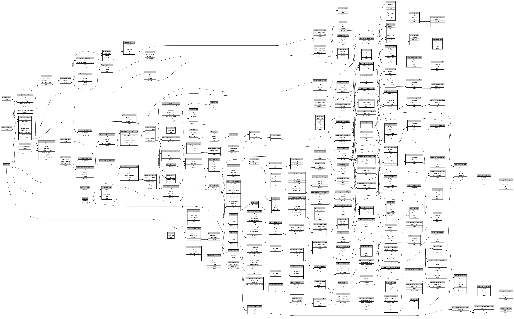

```
# AUTOGENERATED BY ECOSCOPE-WORKFLOWS; see fingerprint in README.md for details

```

```yaml
# fingerprint:
artifacts_sha256_basic: 93ff2800d419baa19795d8a7e4619d18d4307e5fc1cc58d5a5574eb3068a83a7
artifacts_sha256_strict: 2704dbcef64aab0865e6b1f94a8c3133d8bb8d49652b79d1230854c69fd5e259
installed_requirements:
- channel: https://repo.prefix.dev/ecoscope-workflows/
  name: ecoscope-workflows-core
  version: {version: ==0.22.17}
- channel: https://repo.prefix.dev/ecoscope-workflows/
  name: ecoscope-workflows-ext-ecoscope
  version: {version: ==0.22.17}
- channel: https://repo.prefix.dev/ecoscope-workflows-custom/
  name: ecoscope-workflows-ext-custom
  version: {version: ==0.0.39}
- channel: https://repo.prefix.dev/ecoscope-workflows-custom/
  name: ecoscope-workflows-ext-big-life
  version: {version: ==0.0.8}
- channel: https://repo.prefix.dev/ecoscope-workflows-custom/
  name: ecoscope-workflows-ext-ste
  version: {version: ==0.0.18}
params_sha256: 07250e0dac5da6caaf15737bcbe4fc87d9b28a7f346c1c24d971676b4a6e92c2
spec_sha256: 49770ed9a6accb783a2a50f5aedd4d0f0b5d1e2c984ae7b22998b7f60aeb66de

```

# ecoscope-workflows-ste-general-workflow


